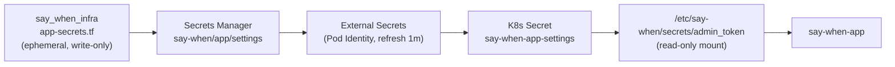

# Cluster App 🍂❄️🌸

A photo-checking chore app built on my AWS EKS + GitOps home lab, written up as a three-season blog series.

Chores go out, photos come back, AWS AI judges them, and a Grafana board turns each chore green or red. Everything is shipped through GitOps onto a locked-down cluster.

| Season | Theme |
| --- | --- |
| **Fall Cleaning: Build It** | The minimum viable product |
| **Winter Cleaning: Weather the Storm** | Reliability and operations |
| **Spring Cleaning: Grow It** | Smarter, more users, cost-aware |

🗺️ **Roadmap:** https://earpjennings37.github.io/say_when_app/roadmap/
📖 **Blog:** https://im-your-huckleberry.com/

## Related repos
- [say_when_infra](https://github.com/earpjennings37/say_when_infra): Terraform for the EKS cluster and AWS services
- [say_when_git_ops](https://github.com/earpjennings37/say_when_git_ops): Argo CD apps that run on the cluster
- [say_when_blog](https://github.com/earpjennings37/say_when_blog): commands and screenshots from each post

## Run it locally

```bash
python3 -m venv .venv
source .venv/bin/activate
pip install -r requirements.txt -r requirements-dev.txt
pytest -q                                   # 14 passed
python -m uvicorn app.main:app --port 8080  # then open http://localhost:8080/docs
```

Or in a container:

```bash
docker build --build-arg APP_VERSION=local-test -t say-when-app:local .
docker run --rm -p 8080:8080 say-when-app:local
```

## Endpoints

| Path | What it does | Public through the gateway? |
| --- | --- | --- |
| `/healthz` | Liveness/readiness check | ✅ |
| `/version` | Image version (`APP_VERSION` build arg) | ✅ |
| `/chores`, `/chores/{id}` | The chore list and each chore's photo rules | ✅ |
| `/docs`, `/openapi.json` | FastAPI's interactive docs | ✅ |
| `/metrics` | Prometheus counters | ❌ scraped from the Service directly |
| `/admin/status` | Confirms the app received its secret. Needs the `X-Admin-Token` header. | ❌ in-cluster only |

## Admin token

`/admin/status` is protected by a token that never lives in Git, the image or Terraform state:



- The app reads the token file **on every request**, so a rotated secret takes effect without a restart.
- **Fail closed:** no file or an empty file returns `503`; a missing or wrong header returns `401`. The token is compared in constant time (`hmac.compare_digest`).
- Override the path with `ADMIN_TOKEN_FILE`. Try it locally:

```bash
echo -n local-token > /tmp/admin_token
ADMIN_TOKEN_FILE=/tmp/admin_token python -m uvicorn app.main:app --port 8080
curl -H 'X-Admin-Token: local-token' http://localhost:8080/admin/status
```

To rotate it in the cluster, bump `secret_string_wo_version` in `say_when_infra/app-secrets.tf` and apply. External Secrets picks up the new value within about a minute.

## How images are built

Every push to `main` runs [`.github/workflows/build.yaml`](.github/workflows/build.yaml):

1. **Test**: the same `pytest` suite you run locally
2. **Build**: native ARM64 runner, matching the cluster's Graviton nodes
3. **Scan**: Trivy fails the build on fixable HIGH/CRITICAL CVEs
4. **Push**: to Amazon ECR using GitHub OIDC (no stored AWS keys)
5. **SBOM**: SPDX inventory of everything in the image
6. **Sign**: Cosign keyless signature plus the SBOM as a signed attestation
7. **Verify**: the signature is checked before the job finishes

Pull requests run steps 1–3 only and never get AWS access.

The OIDC role and the ECR repo come from `say_when_infra/bootstrap/github-actions`. The role trusts only this repo's `main` branch, matched by GitHub's immutable owner and repo IDs.

In the cluster, a Kyverno `ImageValidatingPolicy` in [say_when_git_ops](https://github.com/earpjennings37/say_when_git_ops) runs the same check as `cosign verify` below at admission, in **Deny** mode: a pod in `say-when` whose image isn't signed by this workflow on `main` is rejected.

Verify any image yourself:

```bash
cosign verify <account-id>.dkr.ecr.us-east-1.amazonaws.com/say-when-app@sha256:<digest> \
  --certificate-identity https://github.com/earpjennings37/say_when_app/.github/workflows/build.yaml@refs/heads/main \
  --certificate-oidc-issuer https://token.actions.githubusercontent.com
```
